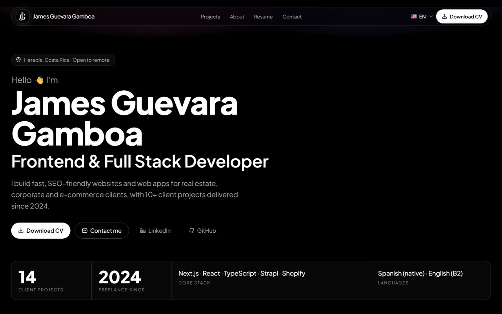
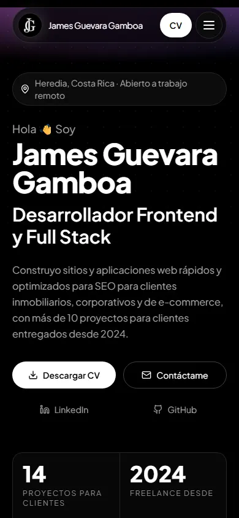
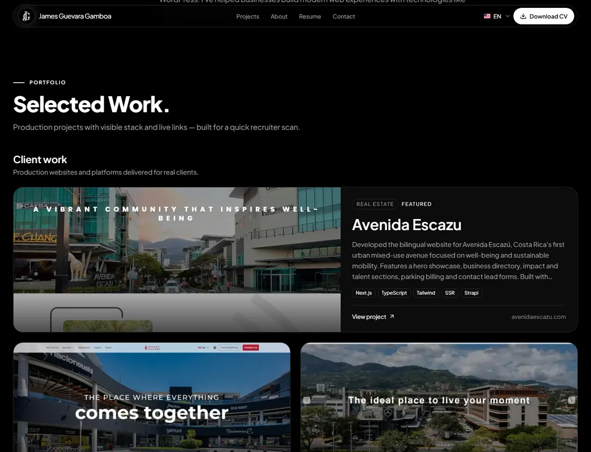
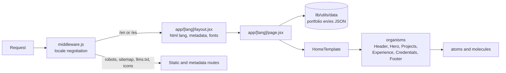

<div align="center">


# James Guevara Gamboa — Portfolio

**Frontend & Full Stack Developer** · Heredia, Costa Rica · Open to work

[](https://james-gamboa.vercel.app/en)
[](#performance-and-quality)
[](#scripts)


[English](https://james-gamboa.vercel.app/en) · [Español](https://james-gamboa.vercel.app/es) · [Download CV](https://james-gamboa.vercel.app/cv/james-guevara-gamboa-cv-en.pdf) · [LinkedIn](https://www.linkedin.com/in/james-guevara-gamboa/)

</div>

<p align="center">
  
  &nbsp;
  
</p>

## What this is

My personal portfolio, built for one job: letting a recruiter understand **who I am, what I build and how to reach me in a few seconds**.

- **Recruiter-first home.** Role, location, availability, a downloadable CV in English or Spanish, and a facts strip computed from real data (client project count, years freelancing, core stack, languages).
- **Real client work first.** 21 production sites for real estate, corporate and e-commerce clients, three featured. Practice projects are listed separately.
- **Bilingual.** English and Spanish routes (`/en`, `/es`) with per-locale metadata, `hreflang`, and `<html lang>`.
- **Experience timeline, certifications and skills.** Includes the Anthropic Academy courses.

<p align="center">
  
</p>

## Performance and quality

Lighthouse on the production site (November 2026):

| Page | Performance | Accessibility | Best Practices | SEO |
| --- | :---: | :---: | :---: | :---: |
| `/en` mobile | 98 | 100 | 100 | 100 |
| `/en` desktop | 100 | 100 | 100 | 100 |
| `/es` mobile | 99 | 100 | 100 | 100 |
| `/es` desktop | 100 | 100 | 100 | 100 |

How it gets there:

- **Text LCP, never hidden by JavaScript.** The hero entrance is CSS-only; the GSAP/Lenis motion engine loads on idle and respects `prefers-reduced-motion`.
- **Self-hosted assets.** Project screenshots are WebP (≤150 KB, 4:3) served through `next/image`; the font is self-hosted with `next/font`. No third-party scripts.
- **SEO and GEO.** `robots.txt` with explicit AI-crawler rules, `sitemap.xml` with language alternates, canonical URLs, Open Graph image per locale, JSON-LD (`WebSite`, `ProfilePage`, `Person`, `FAQPage`) and an [`llms.txt`](https://james-gamboa.vercel.app/llms.txt) summary for AI assistants.
- **Security headers.** Content-Security-Policy, `X-Frame-Options`, `Referrer-Policy`, `Permissions-Policy` and `X-Content-Type-Options`, plus HSTS from Vercel.
- **Privacy-friendly analytics.** Cookie-less Vercel Analytics with conversion events (`cv_download`, `contact_click`, `linkedin_click`, `github_click`).

## How it is built



```text
app/[lang]/        Routes per locale: home, resume, OG image, 404
components/        Atomic design: atoms, molecules, organisms, templates
components/lib/    Dictionaries (en, es)
lib/               SEO, JSON-LD, navigation, analytics, motion, data helpers
lib/utils/data/    Portfolio content in English and Spanish
public/            CV PDFs, project screenshots, llms.txt
docs/              Code quality review and README assets
odd/tasks/         Feature task documents
```

## Getting started

Requires Node.js 22.23.5 (pinned with Volta) and **pnpm** (enforced).

```bash
corepack enable
pnpm install
pnpm dev          # http://localhost:3000
```

## Scripts

| Script | What it does |
| --- | --- |
| `pnpm dev` | Development server |
| `pnpm build` / `pnpm start` | Production build and server |
| `pnpm test` | Vitest suite: SEO helpers, JSON-LD, sitemap/robots, middleware locale resolution, project data, en/es parity |
| `pnpm audit:prod` | Dependency audit for production packages (fails on high/critical) |
| `pnpm audit:node` | Checks the local Node.js version against known vulnerabilities |
| `pnpm audit:lockfile` | Verifies the lockfile matches `package.json` |
| `pnpm audit:secrets` | gitleaks scan of the git history |
| `pnpm audit:sast` | semgrep static analysis (Next.js, React, JavaScript, Node rules) |
| `pnpm validate` | Lockfile, Node, dependency audit and build in one go |

## CI/CD

Vercel deploys through its Git integration (preview per PR, production on `main`). GitHub Actions only verifies; it never deploys.

| Workflow / job | Trigger | What it checks |
| --- | --- | --- |
| `CI` / `test` | PR, push to `main` | `pnpm test` |
| `CI` / `build` | PR, push to `main` | `pnpm build` (with `.next/cache` cache) and the forbidden-files gate on `public/` and `.next/static` |
| `CI` / `audit` | PR, push to `main` | `pnpm audit:lockfile`, `pnpm audit:prod` |
| `CI` / `secrets` | PR, push to `main` | gitleaks over the full git history |
| `CI` / `sast` | PR, push to `main` | semgrep, same rulesets as `pnpm audit:sast` |
| `Post-deploy smoke` / `smoke` | Vercel `deployment_status` = success | Home returns 200; `/.env`, `/.env.local`, `/.git/config`, `/CLAUDE.md`, `/package.json`, `/pnpm-lock.yaml` return 404/403. Previews behind Vercel Deployment Protection (401) are skipped with a notice. |

Dependabot (`.github/dependabot.yml`) opens weekly grouped minor/patch PRs for npm and GitHub Actions, with a 3-day cooldown. `pnpm-workspace.yaml` sets `minimumReleaseAge` so pnpm refuses package versions published less than 3 days ago. All third-party actions are pinned to a full commit SHA.

Run the same checks locally:

```bash
pnpm install --frozen-lockfile
pnpm test && pnpm build
pnpm audit:lockfile && pnpm audit:prod
pnpm audit:secrets   # needs gitleaks
pnpm audit:sast      # needs semgrep
bash scripts/check-forbidden-files.sh public .next/static
```

### GitHub settings to enable (owner, in the UI)

- [ ] Ruleset on `main`: require a pull request, require status checks `test`, `build`, `audit`, `secrets`, `sast` (names must match the job names exactly), block force pushes and deletion
- [ ] Settings > Code security: enable Secret scanning and Push protection
- [ ] Settings > Code security: enable Dependabot alerts and Dependabot security updates
- [ ] Settings > Actions > General: default `GITHUB_TOKEN` permissions set to read-only
- [ ] Settings > Actions > General: require approval for workflow runs from fork pull requests
- [ ] Vercel: keep the Git integration and preview deployments on (the smoke test depends on them)

## Contact

- Email: [jjguevarag@gmail.com](mailto:jjguevarag@gmail.com)
- LinkedIn: [james-guevara-gamboa](https://www.linkedin.com/in/james-guevara-gamboa/)
- GitHub: [James-Gamboa](https://github.com/James-Gamboa)
